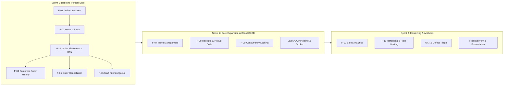

# Three-Sprint Engineering Plan - QuickOrder System

**Course:** CPE 334 Deliverable 1  
**Team Members:**  
- **Patiharn Liangkobkit** (`66070503489`, GitHub: [`@Richyboy170`](https://github.com/Richyboy170))  
- **Tanakrit Sunthonwetchapong** (`67070503464`, GitHub: [`@Tanakrit-triton`](https://github.com/Tanakrit-triton))  
**Domain:** QuickOrder System

---

## 1. Executive Summary & Delivery Schedule

| Sprint | Objective & Milestone | Target Checkpoint | Feature IDs | Primary Completion Outcome |
|---|---|---|---|---|
| **Sprint 1** | **Foundational Vertical Slice & Core Rules:** Authentication, Menu Catalog, Order Placement, Kitchen Queue, Status Progression, and Strict Business Rules. | **Deliverable 1 (8 Nov 2026)** | `F-01`, `F-02`, `F-03`, `F-04`, `F-05`, `F-06` | Working end-to-end user journey across UI, API, and DB with automated tests, reproducible seed data, and reviewed Git integration. |
| **Sprint 2** | **Core Expansion & Cloud Pipeline:** Staff Menu/Stock Management, Digital Receipts/Pickup Codes, High-Concurrency Locking, and GCP Cloud Deployment with CI/CD quality gate. | **Deliverable 2 / Lab 5 (15 Nov - 29 Nov 2026)** | `F-07`, `F-08`, `F-09`, `NFR-04`, `NFR-05`, `NFR-06` | Live GCP deployment on Cloud Run + Cloud SQL; PR merge gate with automated test checks; repeatable release pipeline. |
| **Sprint 3** | **Product Hardening & Operations:** Sales Analytics, Audit Logging, Rate Limiting, User Acceptance Testing (UAT), Defect Remediation, and Final Presentation. | **Progress (29 Nov), Final Complete (13 Dec 2026)** | `F-10`, `F-11` | Fully hardened production system, passing all regression and UAT scenarios, comprehensive documentation, and final demo video. |

---

## 2. Detailed Sprint Work Breakdown

### 2.1 Sprint 1: Baseline Vertical Slice
- **Goal:** Deliver an authenticated, transactional vertical slice connecting the React frontend, Express API backend, and PostgreSQL database.
- **Included Features:**
  - `F-01`: Customer and Staff authentication, password hashing, session tokens, current-user profile (`/api/auth/me`), and logout.
  - `F-02`: Real-time menu browsing with live inventory availability.
  - `F-03`: Customer cart checkout, atomic stock verification and deduction, server-side price computation, order placement in `PENDING` state.
  - `F-04`: Customer personal order history with strict data isolation.
  - `F-05`: Customer order cancellation while in `PENDING` state with stock restoration.
  - `F-06`: Staff order queue with state progression (`PENDING` -> `PREPARING` -> `READY` -> `COMPLETED`).
- **Dependencies:** Node.js runtime, PostgreSQL, Prisma schema migrations, seed dataset.
- **Completion Criteria:**
  - Complete customer flow: Login -> Browse Menu -> Place Order -> View Order -> Cancel Order.
  - Complete staff flow: Login -> View Kitchen Queue -> Advance Preparation Status.
  - Passing automated test suite for unit, integration, and security role permissions.
  - Local setup verified via Docker Compose.

### 2.2 Sprint 2: Core Expansion & Cloud Delivery
- **Goal:** Broaden administrative capabilities and deploy the system to Google Cloud Platform via a verified CI/CD pipeline.
- **Included Features:**
  - `F-07`: Staff CRUD controls for menu items (create, update description/price, restock quantities).
  - `F-08`: Printable digital receipts and unique pickup order reference codes.
  - `F-09`: Database concurrency locking to guarantee zero overselling under simultaneous requests.
  - Cloud Delivery: Cloud Run packaging, Cloud SQL persistence, Secret Manager integration, and GitHub Actions PR check rulesets (`test-and-docker`).
- **Dependencies:** Completion of Sprint 1 release baseline on `main`.

### 2.3 Sprint 3: Hardening, Analytics & Final Delivery
- **Goal:** Fortify system security and resilience, implement operational reporting, execute peer UAT, and finalize product delivery.
- **Included Features:**
  - `F-10`: Administrative sales reporting and revenue analytics.
  - `F-11`: Structured logging, request rate limiting, input sanitization, and automated smoke test verifications.
  - Comprehensive UAT execution with partner team and defect triage log.
- **Dependencies:** Sprint 2 cloud deployment.
